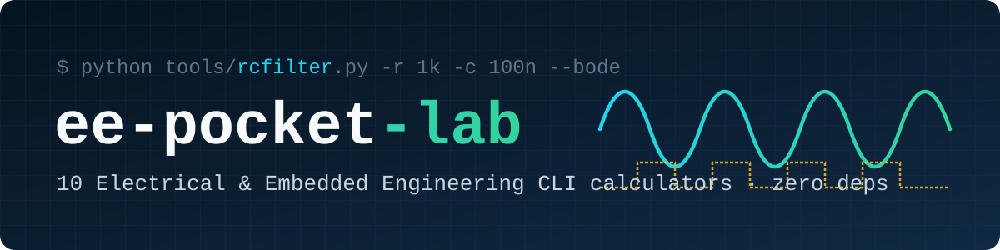

<p align="center">
  
</p>

<p align="center">
  <a href="https://github.com/nguyenminhtriet25052008-hub/ee-pocket-lab/actions/workflows/ci.yml"></a>
  
  
  
  <a href="LICENSE"></a>
</p>

<p align="center">
  <b>10 zero-dependency CLI calculators (~50–80 lines each) for Electrical, Electronics &amp; Embedded Engineering.</b><br>
  No <code>pip install</code>. Instant answers at the lab bench.
</p>

---

## ⚡ The Lab Bench Tools

| Tool | What it solves | Example command |
|------|----------------|-----------------|
| ➗ [`divider`](tools/divider.py) | Voltage divider $V_{\text{out}}$ & automatic **E12/E24 resistor pair finder** | `python tools/divider.py --vin 5 --vout 3.3` |
| 🌊 [`rcfilter`](tools/rcfilter.py) | RC / LC filter cutoff ($f_c$), phase shift & **ASCII Bode plot** | `python tools/rcfilter.py -r 1k -c 100n --bode` |
| 💡 [`ledcalc`](tools/ledcalc.py) | LED series resistor, nearest E24 value & 2× derated power rating | `python tools/ledcalc.py --vs 12 --vf 3.2 --if 15 -n 3` |
| ⏱️ [`ne555`](tools/ne555.py) | NE555 timer Astable (freq, duty cycle) & Monostable pulse width | `python tools/ne555.py astable -r1 1k -r2 10k -c 100n` |
| 📐 [`pcbtrace`](tools/pcbtrace.py) | **IPC-2221** PCB copper trace width, resistance & voltage drop | `python tools/pcbtrace.py --amps 3 --oz 1 --rise 10` |
| 🔺 [`opamp`](tools/opamp.py) | Op-Amp gain (non-inverting & inverting) + E24 pair search | `python tools/opamp.py noninv --gain 11` |
| 🔋 [`battery`](tools/battery.py) | Embedded / IoT battery life from Active + Deep Sleep duty cycle | `python tools/battery.py --mah 2000 --i-active 80 --t-active 2 --i-sleep 0.05 --t-sleep 58` |
| 🔢 [`numbase`](tools/numbase.py) | Hex / Dec / Bin / Oct, two's complement & bit-position inspector | `python tools/numbase.py 0xA5 -w 8` |
| 🛡️ [`crc`](tools/crc.py) | **CRC-8, CRC-16/MODBUS, CRC-16/CCITT, CRC-32** for frames or text | `python tools/crc.py --hex "01 03 00 00 00 0A"` |
| 📈 [`adc`](tools/adc.py) | ADC / DAC resolution, LSB step size, SNR & code ⇄ voltage | `python tools/adc.py --bits 12 --vref 3.3 --vin 1.65` |

## 🚀 Quick Start

```bash
git clone https://github.com/nguyenminhtriet25052008-hub/ee-pocket-lab.git
cd ee-pocket-lab
python tools/divider.py --vin 5 --vout 3.3
```

Every script is standalone and uses only the Python standard library. Run any tool with `--help` to see all options.

## 🎬 Real Bench Demos

<details open>
<summary><b>➗ divider</b>: Find standard E24 resistors for a 5V → 3.3V logic level shifter</summary>

```console
$ python tools/divider.py --vin 5 --vout 3.3
Best E24 pairs for 5 V -> 3.3 V:

      R1        R2       Vout     Error   I_quiescent
   4.7kOhm     9.1kOhm    3.2971V    -0.09%      362.3 uA
    470Ohm      910Ohm    3.2971V    -0.09%     3623.2 uA
    47kOhm      91kOhm    3.2971V    -0.09%       36.2 uA
   6.2kOhm      12kOhm    3.2967V    -0.10%      274.7 uA
    620Ohm     1.2kOhm    3.2967V    -0.10%     2747.3 uA
```
</details>

<details open>
<summary><b>🌊 rcfilter</b>: RC filter cutoff &amp; terminal ASCII Bode plot</summary>

```console
$ python tools/rcfilter.py -r 1k -c 100n --bode
RC Low-Pass Filter  |  fc (-3 dB) = 1.592 kHz  |  tau = 0.1 ms

       Freq  Gain (dB)    Phase  Magnitude (0 dB .. -40 dB)
   15.92 Hz     -0.00     -0.6d  [##############################]
   50.33 Hz     -0.00     -1.8d  [##############################]
   159.2 Hz     -0.04     -5.7d  [##############################]
   503.3 Hz     -0.41    -17.5d  [##############################]
  1.592 kHz     -3.01    -45.0d  [############################  ] <-- fc
  5.033 kHz    -10.41    -72.5d  [######################        ]
  15.92 kHz    -20.04    -84.3d  [###############               ]
  50.33 kHz    -30.00    -88.2d  [#######                       ]
  159.2 kHz    -40.00    -89.4d  [                              ]
```
</details>

<details open>
<summary><b>📐 pcbtrace</b>: IPC-2221 copper trace width &amp; voltage drop</summary>

```console
$ python tools/pcbtrace.py --amps 3.0 --oz 1 --rise 10 --len 40
IPC-2221 (External, 1 oz Cu, +10 C rise) for 3 A:
  Min Trace Width : 1.367 mm  (53.8 mil)
  Over 40 mm len : R = 15.26 mOhm  |  V_drop = 45.79 mV  |  P = 137.4 mW
```
</details>

<details>
<summary><b>🛡️ crc</b>: Verify Modbus RTU &amp; embedded packets</summary>

```console
$ python tools/crc.py --hex "01 03 00 00 00 0A"
Input (6 bytes): 01 03 00 00 00 0A
  CRC-8/SMBus        : 0xB9
  CRC-16/CCITT-FALSE : 0x0428
  CRC-16/MODBUS      : 0xCDC5   (frame append Low-High: C5 CD)
  CRC-32/ISO-HDLC    : 0xDDEBE1C8
```
</details>

<details>
<summary><b>💡 ledcalc · ⏱️ ne555 · 🔺 opamp</b></summary>

```console
$ python tools/ledcalc.py --vs 12 --vf 3.2 --if 15 -n 3
Supply: 12 V  |  LEDs: 3 x 3.2 V  |  Target I: 15 mA
Exact R     : 160.00 Ohm
Standard E24: 160 Ohm  (actual I = 15.00 mA)
Resistor P  : 36.0 mW  ->  Use 1/8 W resistor (2x derated)
Efficiency  : 80.0% of power goes to LED(s)

$ python tools/ne555.py astable -r1 1k -r2 10k -c 100n
NE555 Astable  |  Frequency = 687 Hz  |  Duty Cycle = 52.38%
Period = 1.456 ms  (T_high = 762.5 us, T_low = 693.1 us)

$ python tools/opamp.py noninv --gain 11
Best E24 pairs for noninv Op-Amp with target gain Av = 11 V/V:

       Rf        Rin    Av (V/V)   Gain (dB)     Error
   27kOhm    2.7kOhm    +11.0000     +20.83dB    +0.00%
   30kOhm      3kOhm    +11.0000     +20.83dB    +0.00%
```
</details>

<details>
<summary><b>🔋 battery · 🔢 numbase · 📈 adc</b></summary>

```console
$ python tools/battery.py --mah 2000 --i-active 80 --t-active 2 --i-sleep 0.05 --t-sleep 58
Battery: 2000 mAh (usable 1700 mAh at 85% derating)
Active : 80 mA for 2s  |  Sleep: 0.05 mA for 58s
Duty   : 3.333%  |  Average Current = 2.7150 mA (2715.0 uA)
Runtime: 626.2 hours  (~26.1 days / 0.07 years)

$ python tools/numbase.py 0xA5 -w 8
Width    : 8-bit
Unsigned : 165
Signed   : -91 (two's complement)
Hex / Oct: 0xA5  |  0o245
Binary   : 1010 0101
Set bits : bit 7, bit 5, bit 2, bit 0

$ python tools/adc.py --bits 12 --vref 3.3 --vin 1.65
12-bit ADC/DAC  |  Vref = 3.3 V  |  Full-scale = 0..4095
Step size (1 LSB) = 0.8059 mV  |  Ideal SNR = 74.00 dB
Vin = 1.65 V  ->  Code = 2048 (0x800)  |  Reconstructed = 1.65040 V (err +0.403 mV)
```
</details>

## 🧪 Running Tests

```bash
python -m unittest discover -s tests -v
```

---

## 🇻🇳 Tiếng Việt

**ee-pocket-lab** là bộ 10 công cụ dòng lệnh (CLI) bỏ túi dành cho sinh viên và kỹ sư **Điện - Điện tử & Hệ thống Nhúng**, viết bằng Python chuẩn (**không cần cài thư viện ngoài**):

- ➗ **divider**: Tính cầu phân áp và tự động chọn cặp điện trở chuẩn E12/E24 gần nhất
- 🌊 **rcfilter**: Tính tần số cắt mạch lọc RC/LC và vẽ đồ thị Bode bằng ký tự ASCII
- 💡 **ledcalc**: Tính điện trở hạn dòng và công suất an toàn cho mạch LED nối tiếp
- ⏱️ **ne555**: Tính tần số, chu kỳ nhiệm vụ và độ rộng xung cho IC NE555
- 📐 **pcbtrace**: Tính bề rộng đường mạch in PCB theo tiêu chuẩn IPC-2221 và sụt áp trên đường đồng
- 🔺 **opamp**: Tính độ lợi Op-Amp (đảo / không đảo) và gợi ý cặp điện trở chuẩn E24
- 🔋 **battery**: Ước tính thời lượng pin cho thiết bị IoT (ESP32, STM32...) theo chu kỳ thức / ngủ
- 🔢 **numbase**: Đổi hệ cơ số Hex/Dec/Bin/Oct, số bù 2 và soi từng bit thanh ghi vi điều khiển
- 🛡️ **crc**: Tính mã kiểm tra lỗi CRC-8, CRC-16/MODBUS, CRC-16/CCITT, CRC-32 cho gói tin truyền thông
- 📈 **adc**: Tính độ phân giải LSB, SNR và đổi qua lại giữa điện áp tương tự và mã số ADC/DAC

Được phát triển bởi sinh viên Khoa Điện - Điện tử, Trường Đại học Bách Khoa TP.HCM (HCMUT). Mọi đóng góp và ý tưởng mới đều được chào đón! ⚡

## 📄 License

[MIT](LICENSE) © 2026 Nguyen Minh Triet
